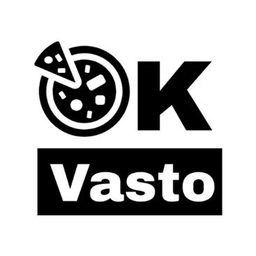

<!-- Improved compatibility of back to top link: See: https://github.com/othneildrew/Best-README-Template/pull/73 -->
<a id="readme-top"></a>

<!-- PROJECT SHIELDS -->
<!--
*** I'm using markdown "reference style" links for readability.
*** Reference links are enclosed in brackets [ ] instead of parentheses ( ).
*** See the bottom of this document for the declaration of the reference variables
*** for contributors-url, forks-url, etc. This is an optional, concise syntax you may use.
*** https://www.markdownguide.org/basic-syntax/#reference-style-links
-->
[![Contributors][contributors-shield]][contributors-url]
[![Forks][forks-shield]][forks-url]
[![Stargazers][stars-shield]][stars-url]
[![Issues][issues-shield]][issues-url]
[![LinkedIn][linkedin-shield]][linkedin-url]


<!-- PROJECT LOGO -->
<br />
<div align="center">
  <a href="https://github.com/CarlinoCalogero/pizzeriaOkayVasto">
    
  </a>

<h3 align="center">Pizzeria Okay Vasto</h3>

  <p align="center">
    Official website for <strong>Pizzeria Okay</strong>, an active restaurant in Italy.
    <br />
    <a href="https://github.com/CarlinoCalogero/pizzeriaOkayVasto"><strong>Explore the docs »</strong></a>
    <br />
    <br />
    <a href="https://github.com/CarlinoCalogero/pizzeriaOkayVasto">View Demo</a>
    &middot;
    <a href="https://github.com/CarlinoCalogero/pizzeriaOkayVasto/issues/new?labels=bug&template=bug-report---.md">Report Bug</a>
    &middot;
    <a href="https://github.com/CarlinoCalogero/pizzeriaOkayVasto/issues/new?labels=enhancement&template=feature-request---.md">Request Feature</a>
  </p>
</div>


<!-- TABLE OF CONTENTS -->
<details>
  <summary>Table of Contents</summary>
  <ol>
    <li>
      <a href="#about-the-project">About The Project</a>
      <ul>
        <li><a href="#built-with">Built With</a></li>
      </ul>
    </li>
    <li>
      <a href="#getting-started">Getting Started</a>
      <ul>
        <li><a href="#prerequisites">Prerequisites</a></li>
        <li><a href="#installation">Installation</a></li>
      </ul>
    </li>
    <li><a href="#usage">Usage</a></li>
    <li><a href="#contributing">Contributing</a></li>
    <li><a href="#contact">Contact</a></li>
    <li><a href="#acknowledgments">Acknowledgments</a></li>
  </ol>
</details>


<!-- ABOUT THE PROJECT -->
## About The Project

This project is the official website for **Pizzeria Okay**, an active restaurant and pizzeria located in Piazza Santa Chiara 51, Vasto (CH), Italy.

Designed for speed, responsiveness, and usability, the website gives customers quick access to the restaurant's complete offerings, location, and contact information:
* **Interactive Digital Menu**: Explore categorized offerings including Classiche, Rosse, Bianche, Speciali, Farine Speciali, Pinse, Calzoni al Forno, Fritture, Desserts, and Bevande.
* **Location & Map**: Integrated Google Maps showing the exact restaurant location in Vasto, Italy.
* **Quick Contact & Booking**: Instant click-to-call buttons for takeaway orders and table reservations.
* **Opening Hours & Social Channels**: Up-to-date schedule and direct links to Instagram and Facebook.

<p align="right">(<a href="#readme-top">back to top</a>)</p>


### Built With

* [![Next][Next.js]][Next-url]
* [![React][React.js]][React-url]
* [![TypeScript][TypeScript]][TypeScript-url]
* [![TailwindCSS][TailwindCSS]][TailwindCSS-url]

<p align="right">(<a href="#readme-top">back to top</a>)</p>


<!-- GETTING STARTED -->
## Getting Started

To get a local copy up and running, follow these simple steps.

### Prerequisites

Ensure you have Node.js (v18+ recommended) and npm installed on your machine.
* npm
  ```sh
  npm install npm@latest -g
  ```

### Installation

1. Clone the repo
   ```sh
   git clone https://github.com/CarlinoCalogero/pizzeriaOkayVasto.git
   ```
2. Navigate to the project directory
   ```sh
   cd pizzeriaOkayVasto
   ```
3. Install NPM packages
   ```sh
   npm install
   ```
4. Run the development server
   ```sh
   npm run dev
   ```
5. Open [http://localhost:3000](http://localhost:3000) in your browser to view the website.

<p align="right">(<a href="#readme-top">back to top</a>)</p>


<!-- USAGE EXAMPLES -->
## Usage

### Development
Start the local Next.js development server with hot-reloading:
```sh
npm run dev
```

### Production Build
Build and export the project as static HTML/CSS/JS assets:
```sh
npm run build
```

The static bundle is exported to the `out/` folder, ready to be deployed to any static web hosting platform (e.g., GitHub Pages or Vercel).

### Code Quality
Run ESLint to check for code consistency and errors:
```sh
npm run lint
```

<p align="right">(<a href="#readme-top">back to top</a>)</p>


<!-- CONTRIBUTING -->
## Contributing

This repository is dedicated to a website for an active restaurant in Italy. For this reason, external contributions and pull requests are **not accepted**.

Thank you for your understanding and interest!

<p align="right">(<a href="#readme-top">back to top</a>)</p>

### Top contributors:

<a href="https://github.com/CarlinoCalogero/pizzeriaOkayVasto/graphs/contributors">
  
</a>


<!-- CONTACT -->
## Contact

**Calogero Carlino** - [LinkedIn][linkedin-url] - carlinocalogero.dev@gmail.com

Project Link: [https://github.com/CarlinoCalogero/pizzeriaOkayVasto](https://github.com/CarlinoCalogero/pizzeriaOkayVasto)

### Restaurant Information
* **Pizzeria Okay**
* **Address:** Piazza Santa Chiara, 51, 66054 Vasto CH, Italy
* **Hours:** Lunedì - Domenica, 18:00 - 23:00
* **Phone:** [(+39) 339 443 1038](tel:+393394431038)
* **Instagram:** [@pizzeria_okay](https://www.instagram.com/pizzeria_okay/)
* **Facebook:** [Pizzeria Okay Vasto](https://www.facebook.com/PizzeriaOkayVasto/)

<p align="right">(<a href="#readme-top">back to top</a>)</p>


<!-- ACKNOWLEDGMENTS -->
## Acknowledgments

* [Next.js](https://nextjs.org/)
* [React Icons](https://react-icons.github.io/react-icons/)
* [Tailwind CSS](https://tailwindcss.com/)
* [Google Maps Platform](https://developers.google.com/maps)
* [Best-README-Template](https://github.com/othneildrew/Best-README-Template)

<p align="right">(<a href="#readme-top">back to top</a>)</p>


<!-- MARKDOWN LINKS & IMAGES -->
<!-- https://www.markdownguide.org/basic-syntax/#reference-style-links -->
[contributors-shield]: https://img.shields.io/github/contributors/CarlinoCalogero/pizzeriaOkayVasto.svg?style=for-the-badge
[contributors-url]: https://github.com/CarlinoCalogero/pizzeriaOkayVasto/graphs/contributors
[forks-shield]: https://img.shields.io/github/forks/CarlinoCalogero/pizzeriaOkayVasto.svg?style=for-the-badge
[forks-url]: https://github.com/CarlinoCalogero/pizzeriaOkayVasto/network/members
[stars-shield]: https://img.shields.io/github/stars/CarlinoCalogero/pizzeriaOkayVasto.svg?style=for-the-badge
[stars-url]: https://github.com/CarlinoCalogero/pizzeriaOkayVasto/stargazers
[issues-shield]: https://img.shields.io/github/issues/CarlinoCalogero/pizzeriaOkayVasto.svg?style=for-the-badge
[issues-url]: https://github.com/CarlinoCalogero/pizzeriaOkayVasto/issues
[linkedin-shield]: https://img.shields.io/badge/-LinkedIn-black.svg?style=for-the-badge&logo=linkedin&colorB=555
[linkedin-url]: https://www.linkedin.com/in/calogero-carlino-2a94a33b5/
[Next.js]: https://img.shields.io/badge/next.js-000000?style=for-the-badge&logo=nextdotjs&logoColor=white
[Next-url]: https://nextjs.org/
[React.js]: https://img.shields.io/badge/React-20232A?style=for-the-badge&logo=react&logoColor=61DAFB
[React-url]: https://reactjs.org/
[TypeScript]: https://img.shields.io/badge/TypeScript-3178C6?style=for-the-badge&logo=typescript&logoColor=white
[TypeScript-url]: https://www.typescriptlang.org/
[TailwindCSS]: https://img.shields.io/badge/Tailwind_CSS-38B2AC?style=for-the-badge&logo=tailwind-css&logoColor=white
[TailwindCSS-url]: https://tailwindcss.com/
